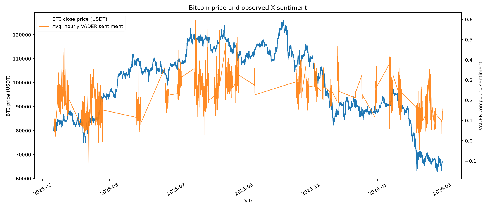
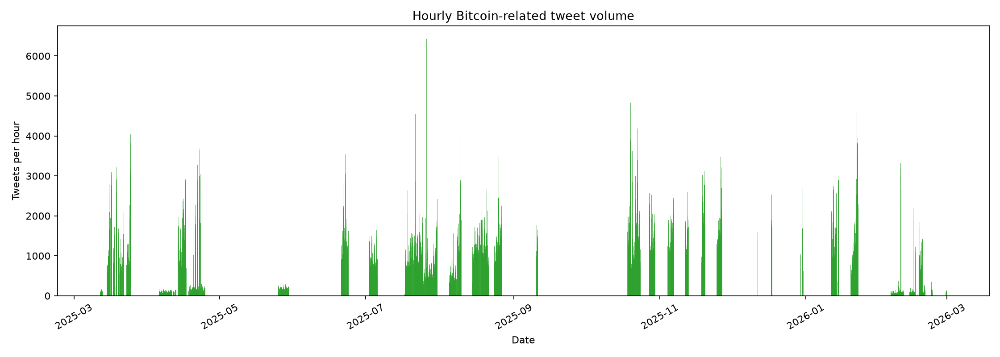
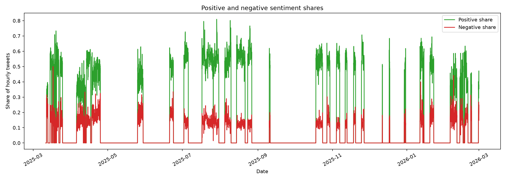
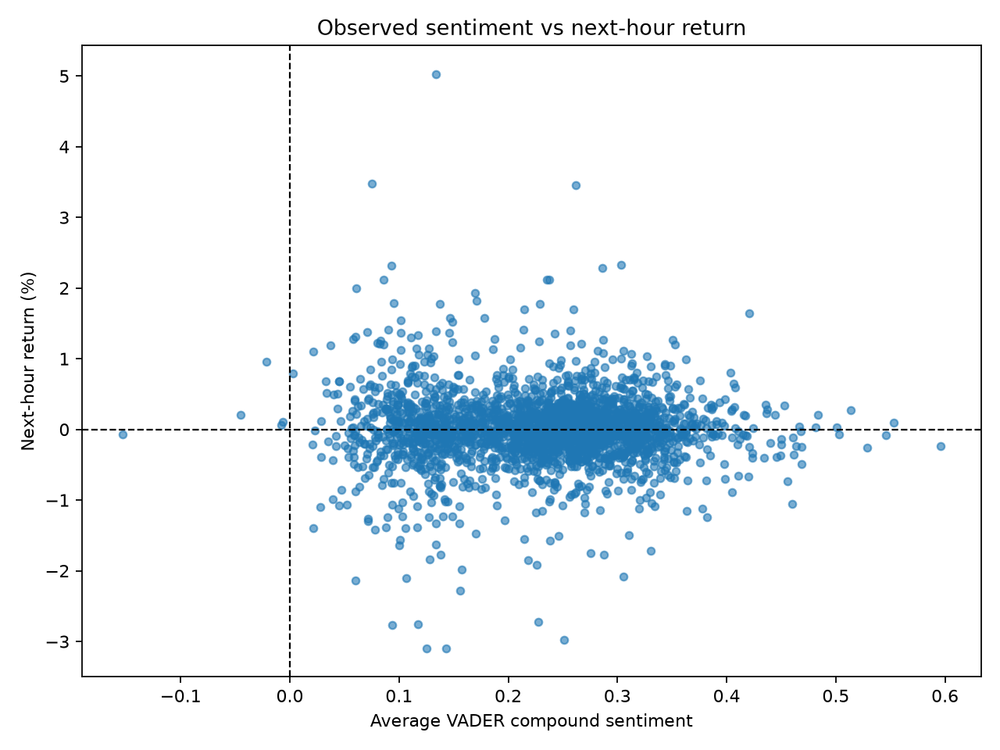
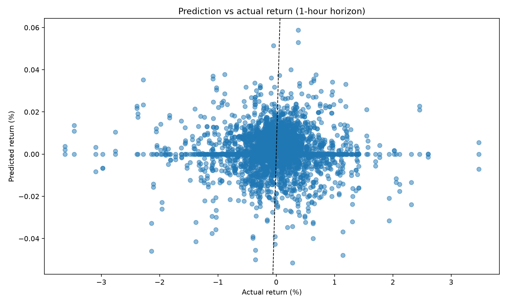
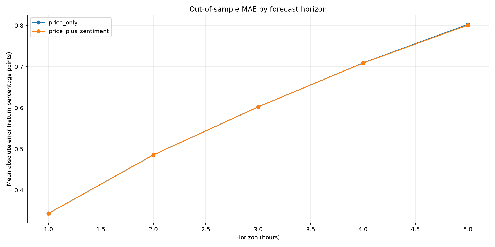

# Evaluation report

Generated: 2026-10-29 07:16 UTC

## Objective and architecture

This project tests whether hourly X-post sentiment improves BTC/USDT return forecasts. The offline pipeline reads the supplied historical data, normalizes/aggregates sentiment, joins it to hourly prices, creates forward return targets, performs chronological walk-forward validation, evaluates a simplified non-overlapping strategy, generates charts, and loads tabular outputs into SQLite. Tavily and Exa news are supplementary context and are not model features.

## Data sources, coverage, and integration status

- Raw X-post export: 4,859,128 rows; 2007-08-17 00:00:08+00:00 to 2026-03-02 23:59:59+00:00 UTC; 198,431 invalid timestamps. File size 1.95 GiB; excluded from Git.
- Scored X-post data used for sentiment: 4,573,496 rows; 2025-03-06 14:42:53+00:00 to 2026-03-02 23:59:59+00:00 UTC; 0 invalid timestamps.
- Latest-180-day requirement: window begins 2026-05-02 UTC; scored data does not reach this window.
- Prices: local hourly BTC/USDT OHLCV file (documented source: Binance).
- Merged modeling sample: 8,514 hourly rows, 2025-03-11 06:00:00+00:00 through 2026-02-28 23:00:00+00:00 UTC.
- Aggregated sentiment timestamps: 2025-03-06 14:00:00 through 2026-03-02 23:00:00 UTC.
- SQLite default path: `data/bitcoin_project.db`; the existing local database was not modified or refreshed.
- Apify: Implemented; not verified because no validated post output is present.
- Tavily: Not verified in this run; no validated output file found (news retrieval is supplementary only).
- Exa: Not verified in this run; no validated output file found (news retrieval is supplementary only).

The exact scored-post coverage is reported above from a chunked scan of the timestamp column. The raw export may contain parseable outlier dates; the scored range is the relevant sentiment-processing coverage. No live collection is claimed unless its validated output exists as noted above. Credentials must be configured locally; API keys are never written to reports.

## Cleaning, features, and targets

Tweet timestamps are converted to UTC; malformed timestamps/text/sentiment are dropped; duplicate IDs (or timestamp/text when IDs are absent) are removed within each processing chunk. Sentiment is computed with VADER, then aggregated hourly into count, mean/median sentiment, positive/negative shares, and follower average when available. Hours without tweets receive zero counts/shares/mean sentiment. Hourly prices are sorted and checked for duplicate timestamps. News data is kept outside the predictive feature set.

Price features are 1h/3h/6h historical returns and log volume. Sentiment features are tweet count, mean/median sentiment, positive/negative shares, and a has-tweets indicator. The target for n+h (h=1..5) is `Close[t+h] / Close[t] - 1`. Binance candle timestamps label the candle open; the signal is available at the current candle close (`hour + 1h`), and the target close occurs at `hour + h + 1h`. Prediction output records both candle labels and these physical signal/target times. The n+0 target is the already completed 1-hour return ending at the current candle close. It is emitted only as a known-current-return diagnostic, not trained, forecast, or included in trading metrics.

## Model and walk-forward design

Price-only and price-plus-sentiment Ridge regression pipelines use median imputation and standardization fitted only on each training fold. Validation is chronological, not shuffled: five expanding folds, 336-hour test windows, and a gap equal to the forward horizon. The zero-return baseline is included for each genuine forward horizon. MAE/RMSE are in decimal return units; directional accuracy is the proportion of non-zero model predictions with the correct sign (undefined for the zero-return baseline).

## Out-of-sample prediction metrics

| Horizon | Model | MAE | RMSE | Directional accuracy | N | Status |
|---:|---|---:|---:|---:|---:|---|
| 0 | known_current_return_reference | — | — | — | 8514 | diagnostic_not_forecast |
| 1 | price_only | 0.003434 | 0.005333 | 0.5101 | 1680 | out_of_sample |
| 1 | price_plus_sentiment | 0.003434 | 0.005333 | 0.5113 | 1680 | out_of_sample |
| 1 | zero_return_baseline | 0.003435 | 0.005330 | — | 1680 | out_of_sample |
| 2 | price_only | 0.004856 | 0.007541 | 0.5167 | 1680 | out_of_sample |
| 2 | price_plus_sentiment | 0.004855 | 0.007542 | 0.5220 | 1680 | out_of_sample |
| 2 | zero_return_baseline | 0.004866 | 0.007545 | — | 1680 | out_of_sample |
| 3 | price_only | 0.006022 | 0.009227 | 0.5042 | 1680 | out_of_sample |
| 3 | price_plus_sentiment | 0.006021 | 0.009227 | 0.5060 | 1680 | out_of_sample |
| 3 | zero_return_baseline | 0.006023 | 0.009230 | — | 1680 | out_of_sample |
| 4 | price_only | 0.007089 | 0.010730 | 0.5125 | 1680 | out_of_sample |
| 4 | price_plus_sentiment | 0.007086 | 0.010724 | 0.5083 | 1680 | out_of_sample |
| 4 | zero_return_baseline | 0.007099 | 0.010729 | — | 1680 | out_of_sample |
| 5 | price_only | 0.008025 | 0.012130 | 0.5065 | 1680 | out_of_sample |
| 5 | price_plus_sentiment | 0.008008 | 0.012110 | 0.5060 | 1680 | out_of_sample |
| 5 | zero_return_baseline | 0.008037 | 0.012120 | — | 1680 | out_of_sample |

Compare price-only with price-plus-sentiment on the same horizons. Small differences are not evidence of a robust edge; no improvement is claimed unless the measured results support it.

## Trading simulation

Signals are read at the current candle close and held until the target candle close, exactly h hours later. Returns are selected without overlapping holding periods; n+0 is excluded. Positions are long for positive predictions, short for negative predictions, and flat for zero predictions. Costs are 10 bps per unit of position turnover, including initial entry, changes, exits across gaps, and final liquidation. Net returns are compounded; annualization assumes 365×24/horizon holding periods per year. Short returns use a linear notional approximation. Slippage, funding, taxes, market impact, and execution delay are not modeled.

| Model | Horizon (hours) | Trades | Net return | Annualized Sharpe | Annualized Sortino | Max drawdown | Cost (bps) |
|---|---:|---:|---:|---:|---:|---:|---:|
| price_only | 1 | 1680 | -70.24% | -12.238 | -15.241 | -70.29% | 10 |
| price_plus_sentiment | 1 | 1680 | -65.61% | -10.729 | -13.438 | -67.29% | 10 |
| price_only | 2 | 840 | -62.61% | -10.104 | -12.593 | -64.72% | 10 |
| price_plus_sentiment | 2 | 840 | -59.85% | -9.367 | -11.639 | -65.87% | 10 |
| price_only | 3 | 560 | -48.46% | -6.700 | -8.700 | -50.15% | 10 |
| price_plus_sentiment | 3 | 560 | -28.30% | -3.241 | -4.544 | -38.93% | 10 |
| price_only | 4 | 420 | -39.01% | -4.981 | -6.178 | -47.42% | 10 |
| price_plus_sentiment | 4 | 420 | -31.98% | -3.841 | -5.003 | -38.30% | 10 |
| price_only | 5 | 336 | -37.53% | -4.483 | -5.611 | -42.57% | 10 |
| price_plus_sentiment | 5 | 336 | -42.73% | -5.352 | -6.516 | -48.61% | 10 |

These are historical simulations, not investment advice or evidence of executable profitability. Sharpe/Sortino ratios are highly sample-dependent.

## Charts

The following assessment chart snapshots are copied from the latest generated charts:













## Limitations and known issues

- Historical data ends at 2026-02-28 23:00:00+00:00; no current latest-180-day post dataset has been verified.
- The raw tweet export and generated outputs are intentionally excluded from Git due to size. Reproducers need the licensed/authorized source data or validated API output.
- Duplicate removal is performed within each processing chunk; repeated records crossing chunk boundaries remain a data-quality risk.
- The selected Apify actor is actor-specific. Inspect its documented input schema and limit/costs; generic search/date input is not assumed.
- API endpoints, credentials, quotas, actor schemas, and service availability were not tested unless a validated output is reported above.
- VADER is a lexicon method and can misread sarcasm, financial context, and non-English text. Sample selection and platform coverage may bias sentiment.
- Model and strategy results do not account for market microstructure, slippage, funding, or operational constraints. Hourly candles may not represent achievable execution prices.
- Hourly aggregation across chunk boundaries can make medians approximate when the same hour spans multiple input chunks.

## Reproduction (Windows PowerShell)

From the project directory:

```powershell
python -m venv .venv
.\.venv\Scripts\Activate.ps1
python -m pip install -r requirements.txt
if (-not (Test-Path .env)) { Copy-Item .env.example .env }
python aggregate_sentiment.py --input data/processed/bitcoin_tweets_with_sentiment.csv
python merge_data.py
python train_model.py
python evaluate_strategy.py
python create_charts.py
python generate_reports.py
python scripts\load_to_sqlite.py --db data\bitcoin_project_rebuilt.db
python -m pytest -q
```

For downloaded posts, first run `python scripts\apify_ingest.py` to inspect actor input and costs. Start a bounded job only after review by passing `--run`; then run `python scripts\process_apify_posts.py` and aggregate both scored files by passing both paths after `--input`. Retrieve optional news with `python scripts\tavily_news.py` and `python scripts\exa_news.py`. Re-running the SQLite loader against an existing database requires explicit `--replace-existing`; `--reset` rebuilds tables.
